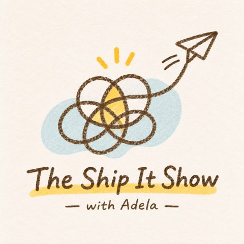

<p align="center">
  
</p>

<h1 align="center">The Ship It Show with Adela</h1>

<p align="center"><b>Finding the Aha Behind Every Product.</b></p>

<p align="center">
  🎧 <a href="https://adelawen.github.io/shipit-show/"><b>所有收聽平台・一頁看完</b></a>
</p>

---

AI 讓做出一個產品變得前所未有地快，但「做得出來」不等於「值得被做」。

每一集，Adela 會邀請一位正在用 AI 做產品的人，聊他們實際怎麼工作、怎麼做決定，以及是在哪一個瞬間，找到那個讓產品成立的「Aha」。聊到技術的時候，也會把 MCP、AI agent、沙盒這些概念用白話講清楚，讓不寫程式的你也能邊聽邊學。

適合想用 AI 做點什麼的人、產品人、工程師，以及每一個對 AI 時代好奇的人。

## 為什麼叫 Ship It × Aha

**Ship it** 是工程師和產品團隊的口頭禪：發布上線、把東西交出去。AI 讓 ship 變得超級快，以前一個團隊做幾個月的東西，現在一個人一個週末就能上線。

但當每個人都能 ship，真正稀缺的就不再是「做得出來」，而是**知道為什麼要做**。**Aha moment** 就是那個「啊！原來是這樣」的瞬間。

所以每一集都在找兩件事：**他們 ship 了什麼，以及那個 Aha 是從哪裡來的。**

## 集數

| 集數 | 類型 | 標題 | 單集資料 |
|:---:|:---:|---|---|
| EP00 | 單人 | AI 叫你裝的套件，可能根本不存在：套件幻覺與 Slopsquatting | [說明・章節・參考資料](episodes/EP00/) |

每集資料夾裡有單集說明、章節時間、節目中提到的參考資料，以及各平台的收聽連結。

## 收聽與追蹤

| 收聽 | 追蹤 |
|---|---|
| Spotify（即將上線） | Instagram（即將上線） |
| Apple Podcasts（即將上線） | Threads（即將上線） |
| YouTube（即將上線） | [LinkedIn](https://www.linkedin.com/in/adelawen) |

想推薦來賓、或有想聽的 Aha 故事？歡迎在 Threads、Instagram 或 LinkedIn 告訴我。

## 關於這個 repo

這裡是節目的**公開資料庫**，也是收聽連結頁的網站原始碼（由 GitHub Pages 發布）。只放已經上架、可以公開的內容。

```
index.html            收聽連結頁
episodes.json         網站讀取的集數清單（最新一集在最上面）
assets/logo.jpg       頻道 logo
episodes/
  ├── EP00/
  │   ├── README.md   單集說明、章節、參考資料、收聽連結
  │   └── cover.jpg   單集封面
  └── _template/      新增一集時複製這個資料夾
docs/新增一集.md       上架新的一集時要改哪些地方
```

---

<p align="center"><i>keep shipping ✈</i></p>
